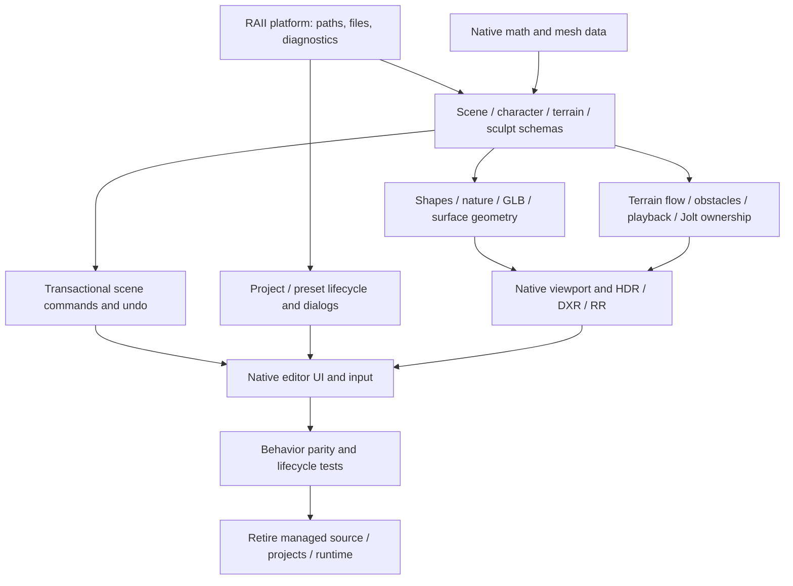

# Native migration discovery

Scope: recursively inventory D:/projects; migrate Starlight-Engine-owned production code. Sibling projects and vendor SDK samples are not Starlight runtime dependencies. Historical backups and generated artifacts remain explicitly inventoried.

Workspace artifacts: 1833; Starlight artifacts: 335; active C# modules: 47.

| Component | Architectural role |
|---|---|
| editor/App.xaml.cs | Editor UI / interaction |
| editor/AuditChecks.cs | Regression tests |
| editor/BuildDock.cs | Editor UI / interaction |
| editor/BuildingTools.cs | Editor UI / interaction |
| editor/ChaosChecks.cs | Regression tests |
| editor/ChaosTools.cs | Editor UI / interaction |
| editor/CharacterSettings.cs | Schemas |
| editor/CornerControlsChecks.cs | Regression tests |
| editor/DenoiseChecks.cs | Regression tests |
| editor/Diagnostics.cs | Diagnostics |
| editor/DialogHistory.cs | Platform dialogs |
| editor/DxrChecks.cs | Regression tests |
| editor/EdgeDimming.cs | Editor UI / interaction |
| editor/EditorChecks.cs | Regression tests |
| editor/EditorCommands.cs | CLI |
| editor/EditorHistory.cs | Editor UI / interaction |
| editor/EffectGeometry.cs | Geometry |
| editor/EffectsTools.cs | Editor UI / interaction |
| editor/FeatureCatalog.cs | Discovery CLI |
| editor/FeaturePanels.cs | Editor UI / interaction |
| editor/FlowObstacles.cs | Simulation |
| editor/FlowTools.cs | Editor UI / interaction |
| editor/ForegroundFocus.cs | Editor UI / interaction |
| editor/FullScreenCanvas.cs | Editor UI / interaction |
| editor/GlbModel.cs | Assets |
| editor/InteractionChecks.cs | Regression tests |
| editor/LocalMusic.cs | Audio |
| editor/MainWindow.xaml.cs | Editor UI / interaction |
| editor/NativeEditor.cs | Editor UI / interaction |
| editor/NativeScene.cs | Renderer transport |
| editor/NativeViewport.cs | Renderer host / PInvoke |
| editor/NatureGeometry.cs | Geometry |
| editor/ObjectGeometry.cs | Geometry |
| editor/ObjectSnapping.cs | Editor UI / interaction |
| editor/PhysicsWorld.cs | Physics / PInvoke |
| editor/PointerInteraction.cs | Editor UI / interaction |
| editor/ProjectWindow.cs | Project/preset UI |
| editor/SceneData.cs | Schemas |
| editor/SculptTools.cs | Mesh editing |
| editor/SurfaceDetail.cs | Geometry |
| editor/TerrainChecks.cs | Regression tests |
| editor/TerrainData.cs | Terrain and geometry |
| editor/TerrainFlow.cs | Simulation |
| editor/TerrainTools.cs | Editor UI / interaction |
| editor/WindowTheme.cs | Editor UI / interaction |
| editor/WorldNavigation.cs | Editor UI / interaction |
| editor/WorldQualityChecks.cs | Regression tests |

## Migration dependency order

## Former managed boundaries (discovery baseline)

WPF owns a child HWND; a managed render worker calls viewport C exports via P/Invoke. SceneData/NativeScene serialize V7 packets into that viewport. PhysicsWorld invokes Jolt C exports. Dialogs and diagnostics cross Windows APIs; music P/Invokes native WinMM MCI. ProjectWindow launches the C++ project host as a child process; local command JSON and a scene FileSystemWatcher coordinate external edits. No managed server process is required by the native viewport. The new build must not launch dotnet or load CLR hosts. Native Windows COM (file dialogs/audio/WIC) is an OS API, not .NET COM interop.

Current implementation and retirement results: see NATIVE-MIGRATION.md. The boundaries above describe the original editor, not the current native build.
